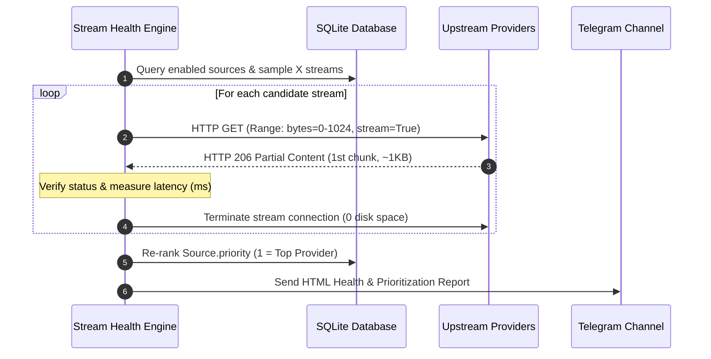

# 🚀 Advanced Features & Integrations

Pream includes native integrations to automate metadata enrichment, system monitoring, and stream reliability.

---

## 🎬 TMDB Metadata Enrichment

By default, many IPTV providers supply low-quality movie covers, missing release years, or empty plot overviews. Pream integrates directly with **The Movie Database (TMDB)** to upgrade your VOD and Series catalogs into a Netflix/Plex-like experience.

### What TMDB Enrichment Provides:
- **High-Resolution Artwork**: High-definition movie posters and backdrop fanart.
- **Rich Metadata**: Verified release years, official plot overviews, and ratings.
- **Genre Tagging**: Genres (e.g. *Action*, *Sci-Fi*, *Documentary*) are attached to items.
- **Standardized Categories**: Optionally organizes movie categories into clean `<LANGUAGE> | <GENRE>` structures (e.g. `EN | Sci-Fi`, `EN | Action`).

### Setup Instructions:
1. Obtain a free v3 API key from [themoviedb.org/settings/api](https://www.themoviedb.org/settings/api).
2. Enter your key in `.env`:
   ```ini
   TMDB_API_KEY=your_32_character_tmdb_api_key
   ```
3. Or save it dynamically via **Settings** > **TMDB API Integration**.
4. During your next source sync or manual refresh, Pream will automatically search TMDB and enrich your catalog.

---

## 📢 Telegram Notifications

Receive automated notifications and instant failure alerts directly on your phone or in a private Telegram channel.

### Types of Notifications Sent:
1. **Refresh Summary Reports**: Sent upon completion of daily cron or manual syncs. Includes total counts for Live channels, VOD Movies, and Series processed, sync duration, and failure warnings.
2. **Instant Source Failure Alerts**: Immediately sent if an upstream source fails due to authentication rejection (`401/403`), expired account, or server offline (`404/500`).
3. **Stream Health Reports**: Detailed breakdown of stream probing passes, latency measurements, and provider promotion/demotion rankings.

### Setup Instructions:

#### Step 1: Create a Telegram Bot
1. Open Telegram and search for `@BotFather`.
2. Send `/newbot` and follow the prompts to choose a bot name and username.
3. Copy the HTTP API token generated (format: `123456789:ABCdefGhIJKlmNoPQRsTUVwxyZ`).

#### Step 2: Obtain your Chat ID
1. For personal messages: Search for `@userinfobot` on Telegram and click Start to get your numerical user ID (e.g. `987654321`).
2. For channels or groups: Add your bot as an Administrator in your channel, send a test message, and use the channel ID (format: `-1001234567890`) or username handle (`@yourchannel`).

#### Step 3: Configure in Pream
Set the variables in `.env`:
```ini
TELEGRAM_BOT_TOKEN=123456789:ABCdefGhIJKlmNoPQRsTUVwxyZ
TELEGRAM_CHAT_ID=-1001234567890
```
Or configure them in **Settings** > **Telegram Notifications**, and click **Send Test Notification** to verify delivery.

---

## 🩺 Stream Health & Auto Re-prioritization

IPTV providers occasionally suffer from dead links, overloaded nodes, or buffering streams. Pream features an automated **Stream Health Engine** that tests random streams across your enabled sources, calculates their reliability scores, and automatically re-ranks their priority.



### Key Technical Details:
- **Zero Disk Space**: Uses HTTP Range headers (`Range: bytes=0-1024`) with streaming requests. Only the first chunk (~1 KB) is read in memory to verify connectivity and stream health. No files are saved to disk.
- **Latency Measurement**: Tracks round-trip response time from request start to the first received byte.
- **Mixed Random Sampling**: Selects up to `X` items (configured by `STREAM_HEALTH_COUNT`, max: 5) randomly mixed across Live TV, Movies, and Series from each provider.
- **Automated Re-ranking**:
  - Calculates `success_rate = (passed / tested) * 100%`.
  - Re-orders sources by highest success rate and lowest average latency.
  - Commits updated `priority` rankings (`1`, `2`, `3`...) to the database so your IPTV players automatically favor the healthiest provider.

### Triggering Stream Health Checks:
1. Navigate to **Settings** > **Actions**.
2. Click **Run Stream Health Check**.
3. A modal opens showing live progress, latency per stream, success rates, and priority shifts.
4. A full report is delivered to your Telegram channel.

---

## 🔀 Zero-Bandwidth Stream Failover

Pream includes an intelligent, transparent stream failover engine. If a primary IPTV source experiences an outage, authentication failure, or network error (`last_status == 'error'`), Pream automatically locates a redundant copy of the requested channel or movie from an alternate healthy provider and redirects your IPTV player directly to it.

```mermaid
sequenceDiagram
    autonumber
    participant Player as IPTV Player (TiviMate / VLC)
    participant Pream as Pream Gateway
    participant ProviderA as Primary Provider (Down)
    participant ProviderB as Secondary Provider (Healthy)

    Player->>Pream: GET /live/{user}/{pass}/123.ts
    Pream->>Pream: Detect Provider A is offline (last_status == 'error')
    Pream->>Pream: Match identical channel on Provider B (by EPG ID or title)
    Pream-->>Player: HTTP 302 Found (Location: http://provider-b.com/live/...)
    Player->>ProviderB: Direct video streaming connection
    Note over Pream,Player: Zero server bandwidth used; playback continues seamlessly!
```

### Key Technical Properties:
- **Zero Server Bandwidth**: Video data is never relayed through Pream. The client player (TiviMate, VLC, etc.) receives an immediate standard HTTP 302 redirect directly to the alternate provider's URL.
- **EPG & Title Matching**: Candidates are prioritized by matching `epg_channel_id` first, followed by normalized display titles.
- **Provider Priority Respected**: Alternate candidates are chosen in ascending order of `Source.priority` (`1` = preferred).
- **Toggleable via Config & Settings**:
  - In `.env`: `STREAM_FAILOVER=true`
  - In Web UI: **Settings** > **Stream Failover & History** > **Zero-Bandwidth Stream Failover**.

---

## 📜 Stream Playback History (30-Day Auto-Retention)

Monitor real-time client consumption and media popularity without filling up your database storage:
- **Recorded Attributes**: Calling client IP address, User-Agent header (identifying player software like TiviMate or VLC), stream title, media type (`movie`, `live`, `series`), and whether failover redirection was triggered.
- **30-Day Auto-Retention**: An automated background routine cleans up records older than 30 days, keeping the database lean and performant.
- **Web UI & API Access**:
  - Inspect the recent stream history table directly on the **Dashboard**.
  - Click **View Full 30-Day Log** to search, filter by media type, and trigger manual purges.
  - REST API endpoint: `GET /api/system/stream-logs`.

---

## 🔐 Encrypted Settings Backup & Restore

Pream features an encrypted backup and restore engine designed to secure sensitive credentials (passwords, bot tokens, API keys) when backing up or migrating installations.

### Cryptographic Security:
- **Key Derivation**: `PBKDF2-HMAC-SHA256` with 100,000 iterations and a cryptographically secure 16-byte random salt.
- **Cipher**: RFC 8439 ChaCha20 stream cipher.
- **Message Authentication**: HMAC-SHA256 authentication tag over salt, nonce, and ciphertext to verify integrity and prevent tampering.
- **Portable**: Implemented in pure Python without requiring external system C libraries or rust toolchains.

### What is Included in Backups:
- **System Settings**: Cron schedules, grouping preferences, TMDB and Telegram configurations.
- **Configured Sources**: Provider URLs, credentials, content scopes, priorities, and sticky User-Agents.
- **Rules Engine Pipeline**: All transformation rules, regex patterns, execution orders, and visibility flags.

### How to Export & Restore:
1. Navigate to **Settings** > **Backup & Restore**.
2. Click **Export Backup**: Enter an optional encryption passphrase (defaults to your current admin password) to download the `.json` file.
3. Click **Import Backup**: Select your `.json` file, choose between **Merge / Update** or **Replace / Overwrite** mode, enter your passphrase, and click Restore. Pream automatically decrypts, restores all tables, and re-applies your rules pipeline.
