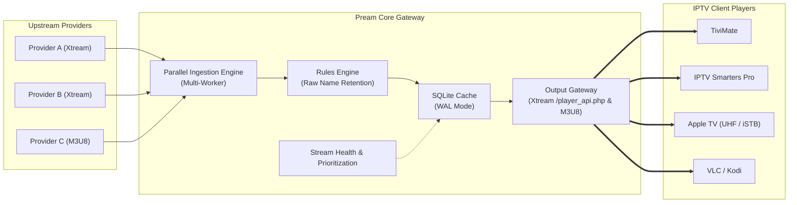

# 📡 Overview & Introduction

**Pream** (Proxy Stream) is an open-source, high-performance, self-hosted IPTV playlist manager and Xtream Codes API gateway built with Python, FastAPI, and SQLite.

Inspired by *Tuliprox*, Pream acts as a central aggregator and transformation gateway between your upstream IPTV providers (Xtream Codes API and M3U playlists) and your downstream client applications (TiviMate, IPTV Smarters Pro, Apple TV, VLC, Kodi, etc.).

---

## 🎯 Why Pream?

If you subscribe to multiple IPTV providers or large playlists, you typically encounter:
1. **Cluttered and Inconsistent Categories**: Redundant or chaotic groups (`UK| SPORTS`, `UK - Sports HD`, `[EN] Sports 50FPS`).
2. **Useless Channels & Bloat**: Thousands of foreign or unneeded channels that slow down player navigation.
3. **Fragile Edits**: Traditional playlist editors permanently alter names upon import; if the provider updates or you change your mind, you have to re-import from scratch.
4. **Server Bandwidth Bottlenecks**: Relaying 4K/FHD video streams through a private server demands massive gigabit bandwidth and CPU transcoding.

**Pream solves every one of these problems:**
- **Zero Bandwidth & Transparent 302 Failover**: Media streams are redirected via HTTP 302, ensuring 0 MB of video stream traffic traverses your server. If a primary provider experiences downtime, Pream automatically 302-redirects to a redundant healthy backup provider.
- **Non-Destructive Rules Engine**: Provider source metadata (`raw_name`, `raw_group`) is preserved forever in SQLite. Transformations (renames, hides, category movements, regex case transformations) are applied cleanly to display fields without modifying raw data.
- **Playback History & Analytics**: Monitor who streams what with calling client IP, media title, player User-Agent logging, and automatic 30-day retention.
- **Encrypted Backup & Migration**: Securely export settings, sources, and rules to encrypted JSON using PBKDF2-HMAC-SHA256 and RFC 8439 ChaCha20.
- **Provider Aggregation & Health Testing**: Merge multiple accounts into one unified catalog with automated stream health probing, latency testing, and priority ranking.

---

## 🏛️ Key Architecture Concepts

### 1. Zero-Bandwidth Stream Playback (HTTP 302 & Direct M3U Links)
Pream operates as a **control-plane gateway**, not a video proxy:
- **Xtream API Gateway (`/live/...`, `/movie/...`, `/series/...`)**: When your IPTV player requests a stream, Pream issues an immediate `HTTP 302 Found` redirect header targeting the upstream provider's authenticated video stream.
- **Direct M3U Generation**: When generating M3U playlists, Pream directly embeds the upstream provider's `stream_url`.
- **Result**: Your player establishes the video connection directly with the provider. Pream uses virtually **zero CPU** and **zero streaming bandwidth**.

### 2. Raw Name Retention Architecture
Unlike conventional playlist management tools that overwrite channel and group names during ingestion:
- **Raw Fields (Immutable)**: `raw_name` and `raw_group` store the untouched strings received from the upstream source.
- **Display Fields (Computed)**: `display_name` and `display_group` are computed dynamically by the Rules Engine.
- **Instant Re-evaluation**: If you create, modify, or delete regex rules, you don't need to re-download 50,000 items from your provider. Clicking **Apply Rules Now** re-transforms the entire database in seconds.

### 3. High-Concurrency SQLite with WAL Mode
Pream uses SQLite optimized for multi-threaded media applications:
- **`PRAGMA journal_mode = WAL`**: Readers (IPTV client requests, Web UI navigation) never block writers (background ingestion, rule execution).
- **`PRAGMA busy_timeout = 30000`**: High-volume transactions wait gracefully up to 30 seconds rather than throwing `database is locked` errors.
- **Dedicated Transaction Lock**: Core batch write operations are coordinated with an asynchronous database lock to guarantee atomic updates.

### 4. User-Agent Cloaking & Stealth Ingestion
Upstream IPTV providers often block automated scrapers or generic HTTP libraries (e.g. `python-requests` or `curl`):
- Pream rotates realistic IPTV player User-Agents (such as *TiviMate*, *IPTV Smarters Pro*, or *VLC*) during ingestion.
- Supports **Sticky User-Agents** per source for providers that pin connections to specific client headers.

---

## 🧭 Navigation Guide

- [Getting Started & Deployment](./getting-started.md) — Set up Pream using Docker Compose or bare-metal Python.
- [Connecting IPTV Players](./clients.md) — Connect TiviMate, Smarters Pro, Apple TV, and VLC.
- [Managing Sources](./sources.md) — Add and manage Xtream and M3U providers, test credentials, and configure sync schedules.
- [Rules Engine & Filtering](./rules-engine.md) — Learn regex-based filtering, group normalization, and 2-column live diff previews.
- [Advanced Features & Integrations](./advanced.md) — Configure TMDB posters/ratings, Telegram notifications, and automated stream health probes.
- [FAQ & Troubleshooting](./faq.md) — Answers to common setup questions and playback tips.
